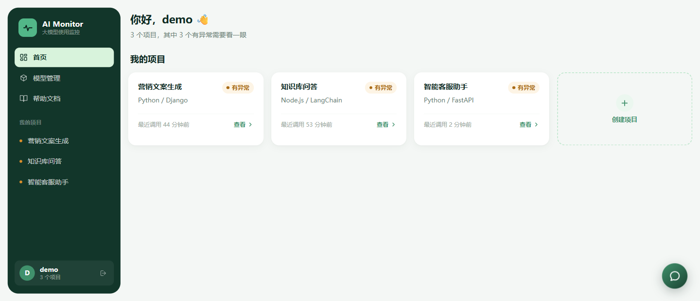
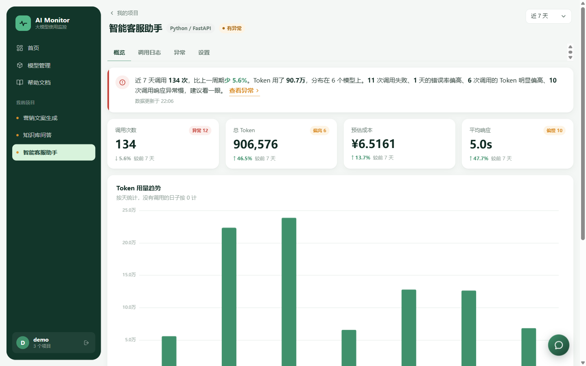
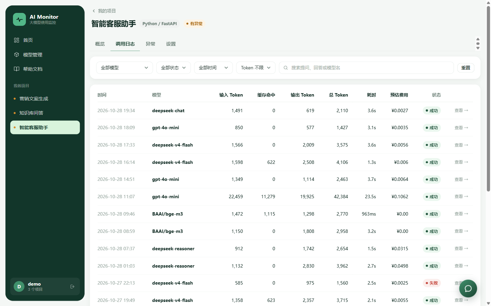
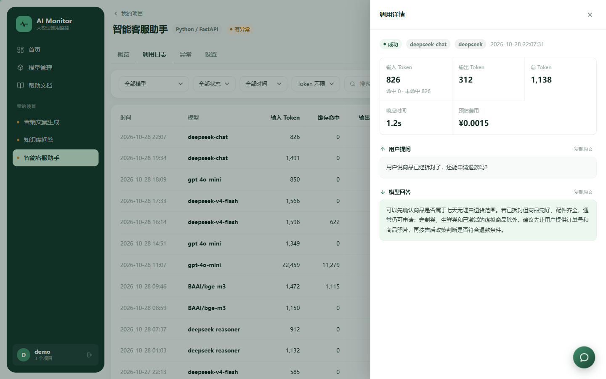
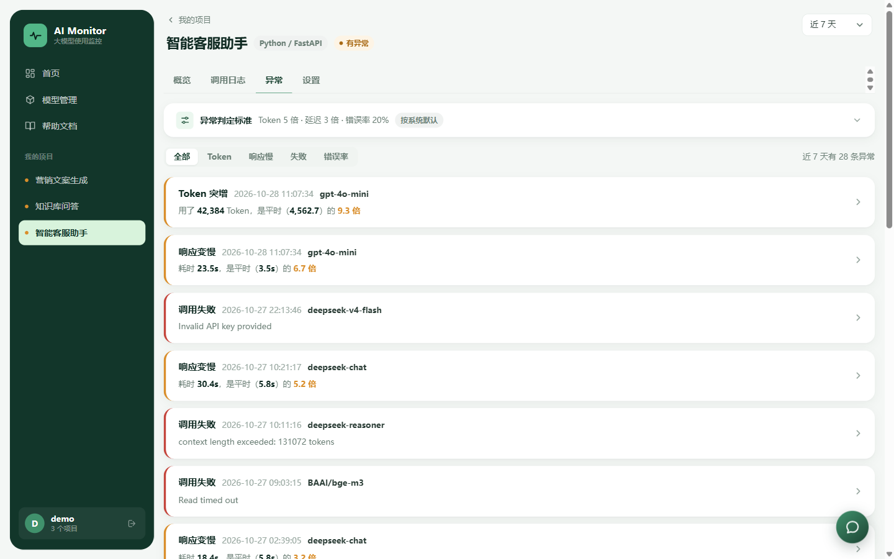
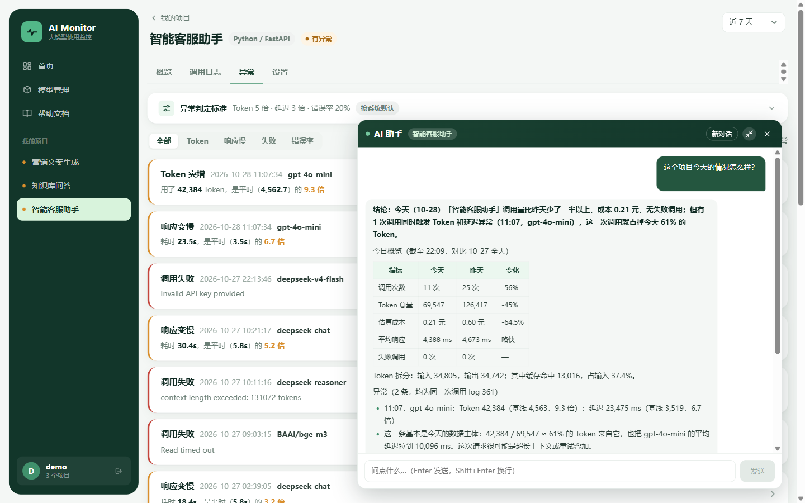
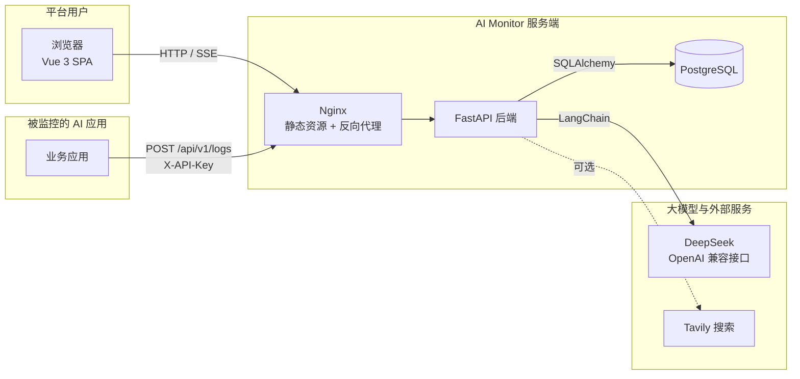

# AI Monitor

> 大模型调用监控与智能分析平台


AI Monitor 把 AI 项目的每一次模型调用，变成四个直接结论：**调了多少次、花了多少钱、哪里不对劲、那次到底问了什么**。

接入方不需要 SDK 或代理层，模型调用完成后发一条 HTTP 请求即可。平台刻意不做 Trace / Span / P95 这类专业概念，目标是让不熟悉可观测性工具的开发者也能直接看懂自己的 AI 应用。

## 项目截图

<table>
  <tr>
    <td width="50%" align="center">
      <br/>
      <sub>首页：项目一览，有异常的项目卡片直接标出</sub>
    </td>
    <td width="50%" align="center">
      <br/>
      <sub>项目概览：调用次数、Token、成本、平均响应与趋势</sub>
    </td>
  </tr>
  <tr>
    <td width="50%" align="center">
      <br/>
      <sub>调用日志：按模型、状态、时间、Token 筛选与全文搜索</sub>
    </td>
    <td width="50%" align="center">
      <br/>
      <sub>日志详情：输入输出 Token、耗时、费用与问答原文</sub>
    </td>
  </tr>
  <tr>
    <td width="50%" align="center">
      <br/>
      <sub>异常分析：Token 突增、响应变慢、调用失败与错误率</sub>
    </td>
    <td width="50%" align="center">
      <br/>
      <sub>AI 助手：自然语言提问，数字全部来自数据库查询</sub>
    </td>
  </tr>
</table>

## 核心功能

- **低侵入上报**：接入方只需发一条 HTTP POST，无需 SDK 或代理层；上报失败不影响接入方业务
- **多项目监控**：项目级 API Key，项目之间数据隔离；首页汇总各项目运行状态，有异常的项目卡片会提示
- **调用统计**：调用次数、Token、成本、平均响应四项指标，支持按时间范围查看趋势与模型占比
- **调用日志**：记录 provider、model、延迟、状态、Token 与成本；支持按模型、状态、时间、Token 量筛选和全文搜索，详情抽屉结构化展示请求与响应 JSON
- **异常分析**：识别 Token 突增、响应变慢、调用失败、错误率偏高四类异常，基于历史均值建立基线，阈值可按项目调整
- **AI 分析助手**：用自然语言查询自己的数据；只读工具调用，所有数字来自数据库查询；支持 SSE 流式输出和会话内多轮追问
- **模型与成本**：内置模型价格表，支持缓存命中分档计价和自建模型价格，成本按上报 Token 与价格表估算
- **管理后台**：管理员维护内置模型价格、管理用户、查看助手用量；看不到用户的项目内容与对话正文
- **帮助文档**：内置公开文档站，覆盖快速开始、使用指南、API 参考与常见问题

## 技术栈

| 分类 | 技术 |
|---|---|
| 前端 | Vue 3、TypeScript、Naive UI、ECharts、Pinia、Vue Router、Vite |
| 后端 | Python 3.11+、FastAPI、SQLAlchemy 2、Pydantic、Uvicorn |
| 数据库 | PostgreSQL 16 |
| AI | LangChain、langchain-openai（DeepSeek OpenAI 兼容接口）、Tavily |
| 部署 | Docker Compose、Nginx |

## 系统架构



生产环境中前端与后端同源，Nginx 负责静态资源和 `/api` 反向代理；本地开发时由 Vite 把 `/api` 代理到后端 8001 端口。

## 快速开始

### 环境要求

- Python 3.11+，依赖用 [uv](https://docs.astral.sh/uv/) 管理
- Node.js 20.19+ 或 22.12+（Vite 8 要求）
- PostgreSQL

### 1. 初始化数据库

先在 PostgreSQL 中创建数据库 `ai_monitor`，然后执行建表脚本：

```bash
cd ai-monitor-backend
psql -d ai_monitor -f sql/schema.sql
```

### 2. 启动后端

```bash
cd ai-monitor-backend
cp .env.example .env.development   # 填写 DATABASE_URL 与 JWT_SECRET_KEY
uv sync
uv run python scripts/init_models.py   # 写入内置模型价格，成本统计依赖它
uv run uvicorn main:app --port 8001
```

需要管理后台时，再创建一个管理员账号：

```bash
uv run python scripts/init_admin.py --username admin
```

健康检查：`curl http://localhost:8001/health` → `{"status":"ok"}`

### 3. 启动前端

```bash
cd ai-monitor-frontend
npm install
npm run dev
```

访问 `http://localhost:5173`，注册账号即可使用。后端端口不是 8001 时，复制 `.env.example` 为 `.env.development`，修改 `VITE_DEV_PROXY_TARGET`。

### 4. 可选配置

- `LLM_API_KEY`：AI 助手使用的模型 Key；不填时助手接口返回 503，其他功能不受影响
- `TAVILY_API_KEY`：助手联网搜索 Key；不填则助手没有联网能力

### 5. 上报一条调用

在平台创建项目、拿到 `proj_` 开头的 API Key 后：

```bash
curl -X POST http://localhost:8001/api/v1/logs \
  -H "X-API-Key: proj_你的Key" \
  -H "Content-Type: application/json" \
  -d '{
    "provider": "deepseek",
    "model": "deepseek-chat",
    "latency": 1200,
    "status": "success",
    "input_tokens": 800,
    "output_tokens": 300
  }'
```

上报原则：调用完成后异步发送、异常就地吞掉、失败调用也要上报。

## 项目目录

```text
ai-monitor/
├─ ai-monitor-backend/
│  ├─ app/
│  │  ├─ api/           HTTP 接口
│  │  ├─ services/      业务逻辑
│  │  ├─ models/        SQLAlchemy 模型
│  │  ├─ schemas/       Pydantic 请求/响应模型
│  │  └─ ai/            AI 助手 Agent、提示词与工具
│  ├─ scripts/          初始化脚本与验收脚本
│  ├─ sql/              schema.sql 与 migrations/
│  └─ main.py           FastAPI 入口
├─ ai-monitor-frontend/
│  ├─ src/
│  │  ├─ views/         页面
│  │  ├─ components/    通用组件
│  │  ├─ api/           接口封装
│  │  ├─ stores/        Pinia 状态
│  │  └─ docs/          内置帮助文档内容
│  └─ dist/             构建产物（npm run build 生成）
├─ deploy/              Dockerfile、Nginx 配置与部署脚本
├─ docker-compose.yml   postgres + backend + nginx 编排
├─ DEPLOY.md            生产部署手册
└─ docs/                开发文档（本地保留，不进版本控制）
```

## 许可证

本项目尚未添加 `LICENSE` 文件，许可证待补充。
