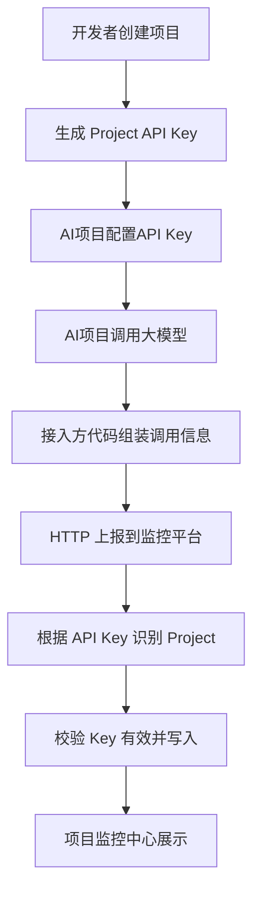

# 模块二：数据接入

> 对应开发阶段：**阶段 6（LLM 调用日志）**。

------

## 1. 模块目标

让外部的 AI 项目能把"每一次大模型调用"的信息上报到平台。

这是整个平台的数据源头 —— **没有这一步，后面的监控、统计、AI 分析全是空的**。

------

## 2. 接入方式：只支持 HTTP 上报

```text
POST /api/v1/logs
```

### 为什么不做 SDK

接入方可能使用任意语言（用户的实际情况：Python LangChain + Java LangChain4j）。维护多语言 SDK 的成本（开发、打包、发布、版本兼容）远高于收益。

**HTTP 接口是跨语言的最小公约数。**

### 为什么不做请求代理

代理模式要求平台转发所有模型请求，涉及流式透传、超时处理、错误透传、链路单点等问题，超出 V1 范围。

### 代价（必须接受）

接入方需要**在自己的业务代码中**组装并上报调用信息：

```text
调用 LLM → 拿到结果 → 组装字段 → POST 到平台
```

------

## 3. 上报内容

一次调用至少记录：

```text
provider
model
input
output
input_tokens
output_tokens
total_tokens
latency
status
error
timestamp
```

### ⚠️ 请求体中不包含 projectId

项目身份由 **API Key 推导**。

理由：如果请求体里带 `projectId`，接入方（或攻击者）就可以伪造它，把数据写进别人的项目。API Key 是服务端可控的凭证。

------

## 4. 字段命名规范

对外 API 的 JSON 字段**统一使用 snake_case**：

```json
{
  "provider": "deepseek",
  "model": "deepseek-chat",
  "input": "什么是 Redis？",
  "output": "Redis 是一种开源的...",
  "input_tokens": 382,
  "output_tokens": 901,
  "total_tokens": 1283,
  "latency": 1820,
  "status": "success",
  "error": null,
  "timestamp": "2026-10-06T11:42:31Z"
}
```

- 后端为 Python，snake_case 是原生风格，无需任何转换
- Java 接入方通过 Jackson 的 `SNAKE_CASE` 命名策略即可适配

> ⚠️ **此约定一经确定不再更改** —— 它是跨语言契约，改动会导致所有已接入项目失效。

------

## 5. 上报流程



------

## 6. 接入方注意事项

### 6.1 上报失败不能影响业务主流程

监控平台不可用时，AI 项目**必须照常运行**。

实现方式由接入方决定，常见做法：

```text
上报调用放到后台线程 / 异步任务
设置较短的超时时间
失败只记录本地日志，不抛异常
```

### 6.2 上报的时机

在一次 LLM 调用**完成后**上报，这样 `input` / `output` / `tokens` / `latency` / `status` 都有值。

失败调用也要上报（`status = "error"`，`error` 填错误信息）—— 失败数据是异常分析的重要来源。

------

## 7. 服务端处理要点

1. **鉴权**：从 `Authorization` 头或请求字段中取 API Key → 查 `api_key` 表 → 校验状态与有效期 → 得到 `project_id`
2. **写入**：组装 `LLMRequest` 记录并入库
3. **成本计算**：按**写入时**的模型价格计算 `estimated_cost` 快照（见模块三 / 模块六）
4. **性能**：上报接口会被高频调用，避免在这里做重计算

------

## 8. 验收标准

- [ ] AI 项目可以通过 HTTP 提交调用日志
- [ ] 可以根据 API Key 自动识别项目
- [ ] 请求体中不含 projectId 也能正确归属
- [ ] 可以记录模型
- [ ] 可以记录输入
- [ ] 可以记录输出
- [ ] 可以记录 Token（input / output / total）
- [ ] 可以记录响应时间
- [ ] 可以记录状态与错误信息
- [ ] 无效 / 过期的 API Key 被拒绝
- [ ] 上报失败不影响接入方业务（需接入方实测）

------

## 9. 开发期的一个现实问题

第 6 阶段之后，你会需要**大量测试数据**来验证统计、图表和 AI 分析功能 —— 但真实的 AI 项目接入是后面的事。

**建议在第 6 阶段就写一个数据播种脚本**，批量生成看起来真实的记录：

```text
跨越 30 天
2～3 个不同模型
成功为主，夹杂失败
包含少数高 Token / 高延迟的异常样本
```

这个脚本是后面 6 个阶段的开发前提，不要等到第 10 阶段才想起来。
