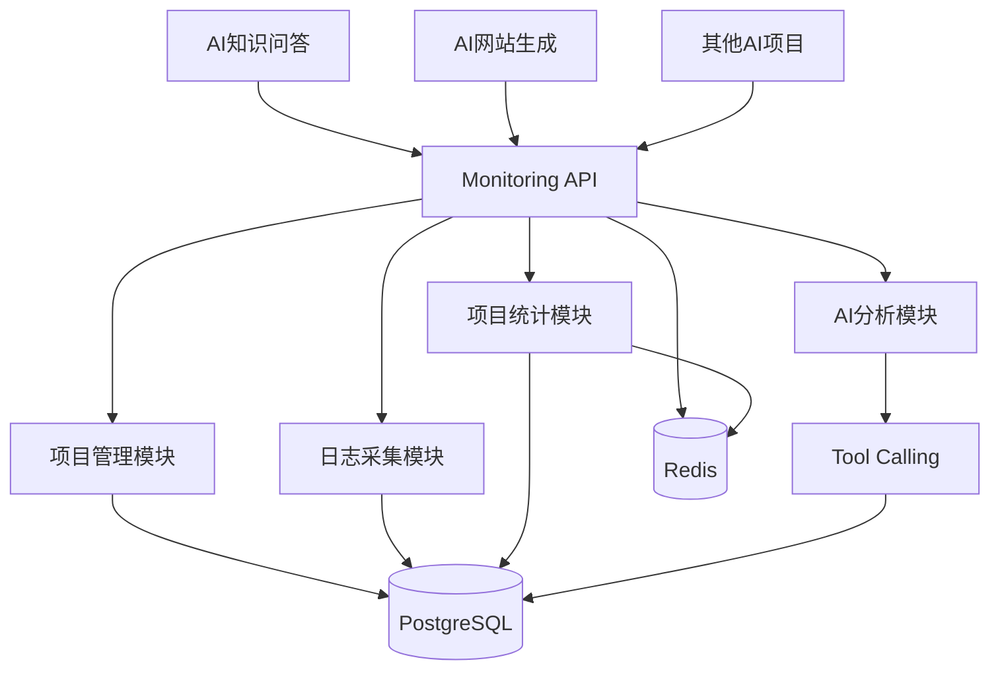

# 模块八：数据模型与技术架构

> 对应开发阶段：**阶段 4（PostgreSQL）、阶段 5（SQLAlchemy）**。

------

## 1. 数据实体总览

```text
User          用户
Project       项目        ← 平台的核心单位
ApiKey        项目密钥    ← 数据上报的凭证
Model         模型与价格
LLMRequest    调用日志    ← 数据量最大的表
```

> 原设计中的独立 `ModelPrice` 表已合并进 `Model` —— 价格是模型的属性，拆成两张表没有收益。

**字段命名统一使用 snake_case**（与对外 API 保持一致）。

------

## 2. 表结构

### 2.1 User

```text
id
username
password_hash      # 存哈希，绝不存明文密码
email
created_at
updated_at
```

### 2.2 Project

```text
id
owner_id           # 归属用户 —— 用户隔离的基础
name
description
status
created_at
updated_at
```

> ⚠️ `owner_id` 不可省略。**所有涉及项目的查询都必须带 `owner_id` 过滤**，这是用户隔离的根本。
>
> 项目数量上限（默认 3）在创建时校验，限制值来自配置项。

### 2.3 ApiKey

```text
id
project_id
key_hash           # 存哈希，不存明文
key_prefix         # 用于界面展示识别，如 proj_a1b2...
status
created_at
expired_at
```

- 一个项目可以拥有一个或多个 API Key
- 使用**密码学安全**的随机数生成（Python `secrets` 模块），不可预测、不可枚举

### 2.4 Model

```text
id
provider
model_name
input_price
output_price
is_builtin         # true = 系统预置
owner_id           # 预置模型为 null，用户自建的为自己的 id
status
created_at
updated_at
```

**归属规则**：

```text
可用模型 = 系统预置（is_builtin = true）∪ 当前用户自建（owner_id = 当前用户）
```

用户修改预置模型的价格时，应**复制**一份成为自己的模型，而不是直接修改全局数据。

### 2.5 LLMRequest

```text
id
project_id         # 归属项目，核心关联字段

provider
model

input
output

input_tokens
output_tokens
total_tokens

latency

status

error_message

estimated_cost     # 写入时按当时价格计算的快照

created_at
```

**没有 `user_id` 字段**：用户归属通过 `Project.owner_id` 推导。全局查询使用 `project_id IN (当前用户的项目)` 即可，避免冗余字段带来的一致性问题。

------

## 3. 隔离机制

### 3.1 两个维度，别混淆

```text
查「项目的数据」  → 过滤 project_id
查「用户的项目」  → 过滤 owner_id
```

| 层 | 功能 | 过滤维度 | 跨项目？ |
|---|---|---|---|
| 隔离区 | 监控中心 / 日志 / 详情 / 统计 / 异常 / 上报 | `project_id` | ❌ 绝不 |
| 聚合区 | 首页项目列表 + 项目状态 | `owner_id` | ✅ 但仅限本人 |
| 聚合区 | AI 助手（全局） | `owner_id` + 多个 `project_id` | ✅ 但仅限本人 |
| 共享区 | 模型 & 价格 | 预置 ∪ `owner_id` | 不属于任何项目 |

### 3.2 三级校验

```text
① 认证层：请求 → 解析出 current_user_id
② 数据层：所有查 Project     → WHERE owner_id = current_user_id
          所有查 LLMRequest  → 先确认所属 project 属于 current_user
③ AI 工具层：project_ids 参数 → 校验每一个都属于 current_user
```

### 3.3 ⚠️ IDOR 防护

前端路由 `/projects/3/logs`，把 `3` 改成 `4` —— 后端必须校验。每个涉及项目的接口都要**两层校验**：

```text
① project 4 存在吗？
② project 4 属于当前登录用户吗？   ← 很多人只写了①
```

建议抽成 FastAPI 依赖（`Depends(get_own_project)`），写一次、全局生效。

------

## 4. 索引设计

### 4.1 必须建立（建表时就建）

```text
llm_request(project_id, created_at)    # 监控中心所有查询的基础
project(owner_id)                      # 首页项目列表
api_key(key_hash)                      # 上报接口鉴权，唯一索引
```

### 4.2 知道但不做（V1）

```text
input / output 的全文检索（pg_trgm + GIN 或 tsvector）
llm_request 按时间分区
```

> 记录在案，避免将来遇到性能问题时的排查困惑。

------

## 5. 技术架构

V1 采用**模块化单体**，不做微服务。



------

## 6. 技术栈

```text
后端    Python 3.11+ / FastAPI / SQLAlchemy / Pydantic
数据库  PostgreSQL / Redis
前端    Vue 3 / TypeScript / Vite / Ant Design Vue / ECharts
AI      OpenAI Compatible API + Tool Calling + LangChain
部署    Docker / Docker Compose
```

### 6.1 部署形态

```text
Nginx
  ↓
Vue
  ↓
FastAPI
  ↓
PostgreSQL
  ↓
Redis
```

------

## 7. 开发阶段路线

```text
 1. Python 项目环境          ← 已完成（uv 初始化）
 2. FastAPI 基础
 3. 项目管理 API
 4. PostgreSQL
 5. SQLAlchemy
 6. LLM 调用日志             ← 同时写数据播种脚本
 7. Token / Cost 统计
 8. Redis
 9. 监控数据分析
10. Vue 前端
11. AI 分析助手
12. Tool Calling
13. Docker
14. 性能优化
```

------

## 8. 待确认事项

| 事项 | 状态 |
|---|---|
| `estimated_cost` 写入时快照 | 已决定采用快照方案（第 5 阶段建表前最终确认） |
| `project_id` 生成方式 | 建议数据库自增；雪花算法在本场景无收益（需分布式 ID 时才引入） |
| Redis 缓存对象 | 第 8 阶段决定，需明确"缓存什么 + 何时失效" |
