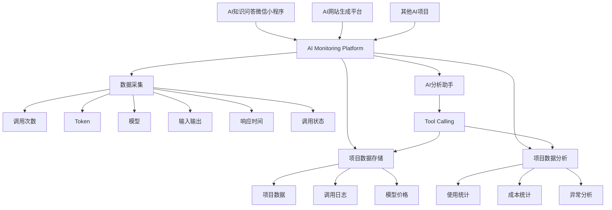
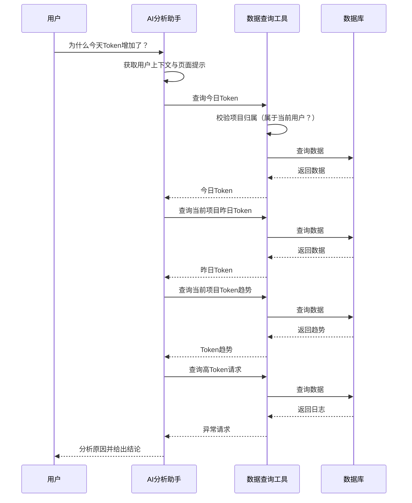
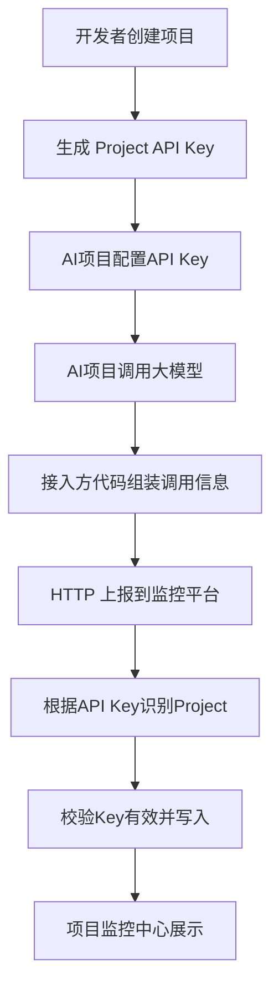
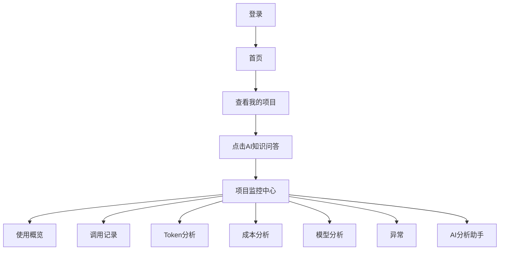
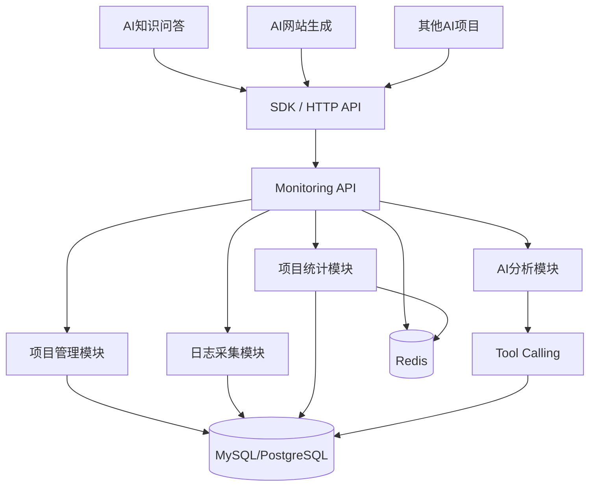
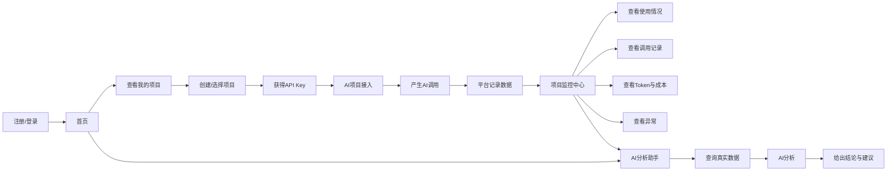

# 轻量级大模型使用监控与智能分析平台

## V1 需求分析文档

**项目版本：** V1.1
**文档类型：** 产品需求分析 / 项目立项文档
**项目定位：** 面向个人开发者和小型团队的轻量级大模型使用监控与智能分析平台

------

## 修订记录

**V1.1 关键变更**（相对 V1.0）：

| 变更 | 位置 | 说明 |
|---|---|---|
| AI 助手改为**全局助手** | 18、21、33 章 | 数据范围 = 当前用户的所有项目；权限硬边界上移到 `user_id` |
| **接入方式只保留 HTTP 上报** | 9 章 | 去掉 SDK 与请求代理两种方式 |
| 字段命名**统一 snake_case** | 9.5、25 章 | 跨语言契约，确定后不再更改 |
| 上报请求体**不含 projectId** | 9.4 章 | 项目身份由 API Key 推导，避免伪造 |
| 数据模型补充关键字段 | 25 章 | `Project.owner_id`、`ApiKey.key_hash`、`Model.owner_id/is_builtin` |
| 新增**项目数量上限** | 8.5 章 | 每用户同时最多 3 个活跃项目（可配置） |
| 明确**异常判定基准** | 23.0 章 | 按模型计算近 7 天滑动基线，N 倍阈值可配置 |
| 明确**成本计算时机** | 13.2 章 | 写入时快照，历史成本不可变 |
| 新增 **AI 工具权限要求** | 21.2 章 | 工具参数必须校验归属，不依赖提示词 |

------

# 一、项目概述

## 1.1 项目背景

随着 ChatGPT、DeepSeek、Qwen、Claude、GPT 等大语言模型被广泛应用，越来越多的个人开发者和小型团队开始在自己的项目中接入大模型。

例如：

- AI 知识问答
- AI 客服
- AI 编程助手
- AI 内容生成
- AI 网站生成
- AI Agent
- 微信小程序 AI 应用

随着项目数量增加，开发者会逐渐遇到以下问题：

1. 不知道自己的项目调用了多少次大模型。
2. 不清楚每天、每周、每月消耗了多少 Token。
3. 不知道不同项目分别消耗了多少 Token。
4. 不清楚大模型调用产生了多少费用。
5. 出现异常请求时，很难快速找到对应日志。
6. 不知道某次请求具体发送了什么内容。
7. 不知道大模型具体返回了什么内容。
8. 当 Token 或费用突然增加时，不知道原因。
9. 现有 LLM Observability 产品功能较多、专业术语较多，对于刚接触大模型的开发者存在一定学习成本。

因此，本项目希望设计一个**更加简单、直观、低学习成本的大模型使用监控平台**。

------

# 二、产品定位

## 2.1 产品定位

本项目定位为：

> **一个面向个人开发者和小型团队的轻量级大模型使用监控与智能分析平台。**

平台帮助开发者统一管理多个 AI 项目，并以**项目为核心的方式**组织监控数据。

用户进入平台后首先看到的是：

```text
我是谁
我有哪些 AI 项目
哪些项目正在运行
```

当用户点击某个项目后，才进入该项目自己的监控中心：

```text
项目
 ↓
使用情况
 ↓
调用记录
 ↓
Token / 成本 / 模型
 ↓
异常
 ↓
AI 分析
```

这样可以避免多个项目的数据混杂在一起，让用户始终明确：

> **“我现在正在看哪个项目？”**

------

## 2.2 核心理念

### 少一点复杂数据，多一点直接结论。

传统监控平台往往存在：

- 大量 Dashboard
- 大量折线图
- Trace
- Span
- Session
- Observation
- P95 / P99
- Evaluation
- Metadata
- Attributes

这些功能对于专业开发团队非常有价值，但对于刚接触大模型的开发者来说，可能会产生较高的理解成本。

本项目采用：

> **默认简单、按需深入**

的设计理念。

整体信息架构：

```text
首页
 ↓
我的项目
 ↓
点击项目
 ↓
项目监控中心
 ↓
具体监控数据
```

首页不承担复杂的数据分析任务。

项目详情页才是：

> **真正的数据监控中心。**

------

# 三、目标用户

## 3.1 个人开发者

适用于：

- 正在学习 AI 开发的开发者
- 独立开发者
- AI 项目开发者
- VibeCoding 开发者
- 拥有多个 AI Demo 的开发者

典型需求：

> “我最近几个 AI 项目分别用了多少 Token？”

------

## 3.2 小型团队

适用于：

- 2～10 人左右的开发团队
- 创业团队
- 小型 AI 应用团队

典型需求：

> “我们现在有哪些 AI 项目？具体哪个项目消耗比较高？”

------

## 3.3 AI 初学者

重点用户群体。

产品应该尽量避免要求用户理解：

- Trace
- Span
- Observation
- P95
- P99

而是直接使用：

- 调用次数
- Token
- 花费
- 响应时间
- 成功率
- 输入
- 输出

------

# 四、产品目标

V1 主要实现以下目标：

## 目标一：统一管理多个 AI 项目

例如：

```text
AI知识问答微信小程序
AI网站生成平台
AI客服
AI内容生成工具
```

都可以接入同一个平台。

------

## 目标二：以项目为单位查看 AI 使用情况

用户首先看到自己的项目：

```text
AI知识问答
AI网站生成平台
AI客服
```

点击某个项目后，再查看：

```text
调用次数
Token
费用
模型
响应时间
日志
异常
```

------

## 目标三：快速了解单个项目的 AI 使用情况

用户进入项目后可以快速知道：

```text
今天调用了多少次？
消耗了多少 Token？
花了多少钱？
平均响应多长时间？
有没有异常？
```

------

## 目标四：查看具体 AI 调用

用户可以查看：

```text
用户输入
AI输出
使用模型
Token
耗时
调用时间
调用状态
```

------

## 目标五：发现项目异常

例如：

```text
某次请求 Token 异常高
项目今天成本突然增加
模型响应时间明显增加
项目出现大量失败请求
```

------

## 目标六：利用 AI 辅助分析项目

用户可以对**全局 AI 分析助手**提问，助手在当前用户的所有项目范围内查询：

> “今天各个项目的使用情况？”

> “为什么今天 Token 比昨天多？”

> “帮我找一下最近的异常请求。”

> “A 项目与 B 项目的用量对比？”

AI 根据**数据库中的真实数据**进行分析，并给出结论。

助手的数据边界是**当前登录用户**：可以访问该用户的所有项目，但无法访问其他用户的数据。

------

# 五、产品整体信息架构

本项目采用：

> **Project-Centric（项目中心化）**

的产品结构。

整体流程：

```text
登录
 ↓
首页
 ↓
用户信息
 ↓
我的项目
 ├── AI知识问答
 ├── AI网站生成平台
 └── 其他项目
       ↓
   点击项目
       ↓
 项目监控中心
 ├── 使用概览
 ├── 调用记录
 ├── Token分析
 ├── 成本分析
 ├── 模型分析
 ├── 异常
 └── AI分析助手
```

------

## 5.1 首页定位

首页不是传统意义上的“大数据 Dashboard”。

首页主要负责：

> **展示用户和项目。**

例如：

```text
你好，开发者 👋

我的项目

┌──────────────────────────────┐
│ 🤖 AI知识问答                 │
│ Python · DeepSeek            │
│ 最近调用：刚刚                │
│ ● 运行正常                   │
│                              │
│ 查看项目 →                   │
└──────────────────────────────┘

┌──────────────────────────────┐
│ 🌐 AI网站生成平台             │
│ Python · DeepSeek            │
│ 最近调用：5分钟前              │
│ ● 运行正常                   │
│                              │
│ 查看项目 →                   │
└──────────────────────────────┘

             + 创建项目
```

首页重点是：

```text
我是谁
我有什么项目
项目现在是否正常
```

而不是：

```text
所有项目加起来用了多少 Token
所有项目加起来花了多少钱
```

------

# 六、产品整体架构



------

# 七、V1 功能范围

V1 主要包含以下模块：

```text
1. 用户与项目管理
2. AI 项目接入
3. 项目监控中心
4. 调用日志
5. 调用详情
6. Token 与成本统计
7. 模型管理
8. AI 分析助手
9. 基础异常分析
```

其中：

> **项目监控中心是 V1 的核心页面。**

------

# 八、模块一：用户与项目管理

## 8.1 用户信息

首页展示基础用户信息：

```text
你好，开发者 👋

我的项目
```

后续可以扩展：

```text
用户名
头像
邮箱
项目数量
```

V1 不需要设计复杂的个人中心。

------

## 8.2 项目概念

平台中的一个 Project 对应一个实际 AI 应用。

例如：

```text
AI知识问答
AI网站生成平台
AI客服
AI写作助手
```

一个项目是：

> **平台进行监控、分析和 AI 解读的基本单位。**

------

## 8.3 项目列表

首页展示用户创建的项目。

项目卡片建议包含：

| 字段     | 说明             |
| -------- | ---------------- |
| 项目名称 | AI 项目名称      |
| 技术栈   | 例如 Python      |
| 默认模型 | 例如 DeepSeek    |
| 最近调用 | 最近一次调用时间 |
| 状态     | 正常 / 异常      |

示例：

```text
我的项目

┌──────────────────────────────┐
│ 🤖 AI知识问答                 │
│                              │
│ Python · DeepSeek            │
│ 最近调用：刚刚                │
│ ● 运行正常                   │
│                              │
│ 查看项目 →                   │
└──────────────────────────────┘
```

------

## 8.4 创建项目

用户点击：

```text
+ 创建项目
```

填写：

```text
项目名称
项目描述
技术栈
```

创建完成后生成：

```text
Project ID
Project API Key
```

## 8.5 项目数量限制

V1 每个用户**同时最多拥有 3 个活跃项目**。

- 限制值通过**配置项**控制（不硬编码在业务代码中），便于后续调整
- 删除项目后释放配额，可以再创建新的项目
- 创建接口在写入前校验当前项目数量，超限时返回明确的错误信息

------

# 九、模块二：AI 项目接入

## 9.1 接入目标

开发者可以将自己的 AI 项目接入平台。

V1 优先支持：

> **HTTP API / SDK 接入**

------

## 9.2 项目 API Key

创建项目后生成：

```text
Project Key
```

例如：

```text
project_xxxxxxxxxxxx
```

不同项目拥有独立的 API Key。

这样可以确保：

```text
AI知识问答 → Project A

AI网站生成 → Project B
```

数据不会混在一起。

------

## 9.3 接入方式

V1 **只支持 HTTP API 上报**，不提供 SDK，也不做请求代理。

AI 项目在每次调用大模型后，向平台提交这次调用的信息：

```text
POST /api/v1/logs
```

### 为什么不做 SDK

接入方可能使用任意语言（Python、Java、Node 等）。维护多语言 SDK 的成本（开发、打包、发布、版本兼容）远高于收益。HTTP 接口是跨语言的最小公约数。

### 为什么不做请求代理

代理模式要求平台转发所有模型请求，涉及流式透传、超时处理、错误透传、链路单点等问题，超出 V1 范围。

### 接入方注意事项

- **上报失败不能影响业务主流程** —— 监控平台不可用时，AI 项目必须照常运行
- 请求体中**不包含 projectId** —— 项目身份由 API Key 推导，避免伪造

------

## 9.4 V1 接入信息

一次调用至少记录：

```text
provider
model
input
output
input_tokens
output_tokens
total_tokens
latency
status
error
timestamp
```

注意：请求体中**不包含 projectId**，项目身份由 API Key 推导。

## 9.5 字段命名规范

对外 API 的 JSON 字段**统一使用 snake_case**（如 `input_tokens`、`total_tokens`）。

- 后端为 Python，snake_case 是原生风格，无需任何转换
- Java 接入方通过 Jackson 的 `SNAKE_CASE` 命名策略即可适配

> ⚠️ 此约定一经确定不再更改 —— 它是跨语言契约，改动会导致所有已接入项目失效。

------

# 十、模块三：项目监控中心

## 10.1 页面定位

用户点击项目后进入：

> **项目监控中心**

例如：

```text
AI网站生成平台

概览
调用记录
Token
成本
模型
异常
AI分析
```

这是整个系统最核心的页面。

------

# 十一、项目监控中心：首页概览

## 11.1 核心指标

进入某个项目后，首先展示该项目的：

```text
今日调用次数
今日 Token
今日费用
平均响应时间
```

例如：

```text
AI网站生成平台

今日使用情况

┌──────────┐
│ 110      │
│ 调用次数 │
└──────────┘

┌──────────┐
│ 600K     │
│ Token    │
└──────────┘

┌──────────┐
│ ¥1.54    │
│ 预计费用 │
└──────────┘

┌──────────┐
│ 2.8s     │
│ 平均响应 │
└──────────┘
```

所有这些数据都只属于：

> **AI网站生成平台。**

------

## 11.2 最近调用

展示当前项目最近的调用：

```text
最近调用

11:42
生成奶茶店官网
18,293 Token
2.8s
成功

11:39
修改首页布局
8,321 Token
2.1s
成功
```

------

## 11.3 异常提醒

如果项目存在异常：

```text
需要注意

⚠️ 最近出现 3 次高 Token 请求

⚠️ 今天出现 2 次 API Timeout
```

------

# 十二、项目监控中心：Token 分析

## 12.1 Token 统计

支持：

```text
今日
近7天
近30天
自定义时间
```

统计：

```text
调用次数
输入 Token
输出 Token
总 Token
```

------

## 12.2 Token 趋势

例如：

```text
Token 使用趋势

周一   120K
周二   150K
周三   180K
周四   240K
周五   600K
```

重点不是展示复杂图表，而是帮助用户回答：

> **“这个项目最近是不是越来越耗 Token？”**

------

# 十三、项目监控中心：成本分析

## 13.1 成本统计

展示：

```text
今日费用
近7天费用
近30天费用
```

例如：

```text
本项目近7天预计费用

¥8.62
```

并给出简单结论：

```text
相比上周：
↑ 32%

主要原因：
单次请求 Token 增加
```

## 13.2 成本计算方式

成本计算公式：

```text
estimated_cost = input_tokens  / 1_000_000 × input_price
               + output_tokens / 1_000_000 × output_price
```

**计算时机：写入时快照（V1 采用）**

日志写入时，按**当时**的模型价格算好 `estimated_cost` 存入 `LLMRequest` 表。

- 历史成本不可变 —— 后续调整模型价格，不影响已有日志
- 查询快 —— 统计时直接对 `estimated_cost` 求和，无需 join 价格表
- 代价：价格修正后无法追溯重算历史成本（V1 可接受）

> 说明：Token 用量来自模型返回的 usage 字段，可能本身存在偏差，因此平台展示的成本始终是"**预计**费用"。

------

# 十四、项目监控中心：模型分析

## 14.1 模型使用情况

查看当前项目使用了哪些模型：

```text
DeepSeek Chat
使用 82%

DeepSeek Reasoner
使用 18%
```

可以查看：

```text
调用次数
Token
成本
平均响应时间
```

------

# 十五、模块四：调用日志

## 15.1 功能

用户进入当前项目的：

```text
调用记录
```

查看该项目所有大模型调用。

------

## 15.2 日志字段

| 字段       | 说明         |
| ---------- | ------------ |
| 时间       | 调用时间     |
| 模型       | 使用的大模型 |
| 输入 Token | 输入 Token   |
| 输出 Token | 输出 Token   |
| 总 Token   | 总 Token     |
| 耗时       | 请求耗时     |
| 状态       | 成功 / 失败  |
| 成本       | 本次调用成本 |

注意：

> 日志页面默认只显示当前项目的数据。

------

## 15.3 日志筛选

支持：

```text
模型
时间范围
状态
Token 范围
```

------

## 15.4 搜索

支持根据：

```text
用户输入
AI输出
模型名称
```

进行搜索。

**实现提示（性能）**：`input` / `output` 是大文本字段，直接用 `LIKE '%关键词%'` 会触发全表扫描，数据量增长后查询会明显变慢。

- V1 数据量可控，可以先这样实现，但要知道这个瓶颈的存在
- 后续优化方向：PostgreSQL 的 `pg_trgm` 扩展 + GIN 索引，或全文检索（`tsvector`）
- 无论如何，`project_id` 和 `created_at` 的索引**必须从一开始就建立**

------

# 十六、模块五：调用详情

点击某条日志后进入详情。

------

## 16.1 基础信息

```text
调用详情

项目：
AI知识问答

模型：
DeepSeek

时间：
2026-10-06 11:42:31

耗时：
1.82s

状态：
成功
```

------

## 16.2 Token 信息

```text
Token

输入：
382

输出：
901

总计：
1,283
```

------

## 16.3 用户输入

```text
用户输入

什么是 Redis？
```

------

## 16.4 AI 输出

```text
AI 输出

Redis 是一种开源的...
```

------

## 16.5 错误信息

如果请求失败：

```text
请求失败

错误类型：
API Timeout

错误信息：
Request timeout after 30s
```

------

# 十七、模块六：模型管理

## 17.1 支持多模型

平台不应该与 DeepSeek 强绑定。

V1 设计为支持：

```text
DeepSeek
OpenAI
Qwen
Claude
其他兼容模型
```

------

## 17.2 模型信息

例如：

```text
DeepSeek Chat

Provider：
DeepSeek

Model：
deepseek-chat

输入价格：
xxx / 1M Token

输出价格：
xxx / 1M Token
```

------

## 17.3 自定义模型

允许用户添加：

```text
模型名称
Provider
输入 Token 价格
输出 Token 价格
```

这样未来更换模型时无需修改系统核心代码。

------

# 十八、模块七：AI 分析助手

这是 V1 的特色功能之一。

## 18.1 产品定位

AI 分析助手不是普通聊天机器人。

它的定位是：

> **帮助开发者理解自己所有 AI 项目的使用数据。**

助手是**全局的**：首页和项目页面**共用同一个助手**，数据范围覆盖当前用户的全部项目。

------

## 18.2 数据范围（硬约束）

助手的查询范围：

```text
当前登录用户的所有项目（V1 最多 3 个）
```

这是**硬边界**，由服务端在工具执行层强制校验（见第三十三章 原则六、七）。

助手无论如何都无法访问其他用户的数据 —— 这一点不依赖模型的"自觉"，而由代码保证。

------

## 18.3 页面上下文（软约束）

用户在不同页面提问时，助手会知道"用户当前正在看哪个页面"：

```text
首页提问           → 无特定项目上下文，默认理解为"所有项目"
项目 A 页面提问     → 上下文提示"用户正在查看项目 A"
```

例如用户在「AI网站生成平台」页面询问：

> “为什么最近 Token 使用量这么高？”

助手会**倾向于**理解为在问当前项目。

但要注意这是**软约束**：

- 它的作用是帮助助手**理解用户意图**，不是限制数据访问范围
- 助手理解错了，最坏结果是答非所问，用户重问一次即可
- 用户可以在任意页面提问跨项目的问题，例如：

> “A 项目与 B 项目的用量对比”

> “今天各个项目的使用情况”

------

## 18.4 与原设计的差异说明

原设计为"默认绑定当前项目，用户明确要求才允许跨项目"。现调整为**全局助手**，原因：

1. 判断"用户是否明确要求跨项目"如果交给模型做，等于把权限边界交给了一个会出错、且可能被诱导的组件
2. 改为全局助手后，权限边界上移到**用户级**（`user_id`），而 `user_id` 来自服务端的登录态，模型完全无法影响
3. 权限模型因此**更简单也更安全**：不需要意图识别，只需要归属校验

------

# 十九、用户可以如何询问 AI

单项目问题（在某个项目页面提问）：

```text
为什么今天 Token 比昨天多？

最近哪个请求最耗 Token？

帮我找一下最近的异常请求。

最近使用最多的是哪个模型？

为什么这个项目最近费用增加了？

帮我分析一下最近7天的使用情况。

最近响应速度有没有变慢？

帮我看看有没有异常调用。
```

跨项目问题（任意页面都可以问）：

```text
今天各个项目的使用情况？

A 项目与 B 项目的用量对比？

哪个项目这个月花钱最多？

所有项目加起来今天用了多少 Token？
```

------

# 二十、AI 分析助手工作流程



------

# 二十一、AI 工具设计

AI 不应该直接“猜测”平台数据。

需要通过工具获取真实数据。

## 21.1 工具清单

V1 设计以下工具：

```text
list_projects()
```

列出当前用户的所有项目（名称 + ID）。

> **当用户提到具体项目名称时，助手必须先调用此工具把名称解析成 ID** —— 不允许凭空猜测项目 ID。

------

```text
get_project_usage(project_ids, start_date, end_date)
```

查询指定项目的整体使用情况（调用次数、Token、费用、平均响应时间）。

`project_ids` 为空时，查询当前用户的全部项目。

------

```text
get_token_usage(project_ids, start_date, end_date)
```

查询指定项目的 Token 使用情况。

------

```text
get_cost_statistics(project_ids, start_date, end_date)
```

查询指定项目的成本统计。

------

```text
get_recent_logs(project_ids, limit)
```

查询指定项目的最近调用日志。

------

```text
get_error_logs(project_ids, limit)
```

查询指定项目的错误日志。

------

```text
get_model_usage(project_ids, start_date, end_date)
```

查询指定项目的模型使用情况。

------

```text
get_usage_trend(project_ids, start_date, end_date, granularity)
```

查询指定项目一段时间内的使用趋势。

------

## 21.2 工具权限（重要）

工具的 `project_ids` 参数由模型填值，**但填进来的值不可信**。

每个工具的实现中必须强制校验：

```text
project_ids 里的每一个 ID
  → 是否都属于当前登录用户？
  → 否：直接拒绝，不返回任何数据
```

**为什么参数可以交给模型填**：

> 模型负责"决定查什么"，服务端负责"决定能查什么"。

**为什么不能只靠提示词约束**：

> 提示词是建议，代码是保证。提示词挡不住模型的理解偏差，也挡不住 prompt injection。

------

## 21.3 工具返回值要求

- 返回值中**必须带上项目名称**，便于用户核对助手是否查对了项目
- 返回给模型的数据要**经过聚合**，不要堆砌原始记录
- 数据超出合理范围时（如日志条数过多），只返回关键摘要

------

# 二十二、AI 分析示例

用户当前位于：

```text
AI网站生成平台
```

用户：

> 为什么今天 Token 比昨天多？

系统查询：

```text
昨日：
350K

今日：
600K
```

继续查询：

```text
今日调用次数：
110

昨日调用次数：
80
```

继续查询：

```text
平均单次 Token：

昨日：
4.3K

今日：
5.4K
```

继续查询高 Token 请求：

```text
今日最大请求：

18,293 Token
```

AI 最终回答：

> 今天 Token 比昨天增加约 71%，主要有两个原因：
>
> 1. 调用次数从 80 次增加到 110 次；
> 2. 平均单次 Token 从约 4.3K 增加到 5.4K。
>
> 另外，今天存在一次 18K Token 的高消耗请求，建议检查该次网站生成请求是否携带了过多上下文或完整代码。

------

## 22.1 跨项目分析示例

用户当前位于**首页**（无项目上下文）：

> 今天各个项目的使用情况？

系统流程：

```text
1. list_projects()                     → 得到 3 个项目及 ID
2. get_project_usage([1,2,3], 今日)    → 校验归属 → 查询汇总
```

AI 最终回答：

> 今天三个项目的情况：
>
> 1. **AI网站生成平台** —— 110 次调用，600K Token，¥1.54
> 2. **AI知识问答** —— 42 次调用，180K Token，¥0.46
> 3. **AI客服** —— 15 次调用，52K Token，¥0.13
>
> 消耗最高的是 AI网站生成平台，占今日总 Token 的 72%。需要我分析它为什么高吗？

------

## 22.2 项目对比示例

用户当前位于「AI知识问答」项目页面：

> AI网站生成平台和 AI知识问答的用量对比？

系统流程：

```text
1. list_projects()                  → 解析项目名称 → 得到 ID
2. get_token_usage([1,2], 近7天)    → 校验归属 → 查询
```

> **注意**：即使用户当前在「AI知识问答」页面，助手仍然可以查询「AI网站生成平台」—— 页面上下文只是**提示**，不是**限制**。

------

# 二十三、模块八：基础异常分析

V1 不需要复杂的 AI Evaluation。

先实现简单规则。

## 23.0 异常判定基准

"正常"必须有明确的定义才能实现。V1 采用**滑动基线**：

```text
基线 = 该模型近 7 天的平均 Token / 平均响应时间

Token 异常    ：本次 total_tokens > 基线 × 5
响应时间异常  ：本次 latency     > 基线 × 5
```

约束：

- 倍数阈值（默认 5）通过**配置项**控制
- **按模型分别计算基线** —— 不同模型的正常水位差异很大
- 样本不足时（如近 7 天该模型调用次数 < 10）不做异常判定，避免误报

> V1 不使用统计学方法（分位数、标准差等），规则越简单越容易解释和调试。

------

## 23.1 Token 异常

例如：

```text
正常平均：
2,000 Token

当前：
25,000 Token
```

系统标记：

> ⚠️ Token 使用异常

------

## 23.2 响应时间异常

例如：

```text
正常：
2s

当前：
15s
```

标记：

> ⚠️ 响应时间异常

------

## 23.3 调用失败

例如：

```text
API Error
Timeout
Rate Limit
```

统一记录。

------

# 二十四、异常数据展示

异常只针对当前项目。

例如：

```text
AI网站生成平台

需要注意

⚠️ 最近出现 3 次高 Token 请求

⚠️ 今天出现 2 次 API 超时
```

点击后直接进入：

```text
异常日志
```

------

# 二十五、数据模型

V1 至少包含以下核心实体：

```text
User
Project
ApiKey
Model
LLMRequest
```

> 原 `ModelPrice` 与 `Model` 合并 —— 价格是模型的属性，拆成两张表没有收益。

**字段命名统一使用 snake_case**（与对外 API 保持一致）。

------

## 25.1 User

```text
id
username
password_hash      # 存哈希，绝不存明文密码
email
created_at
updated_at
```

------

## 25.2 Project

```text
id
owner_id           # 归属用户 —— 用户隔离的基础
name
description
status
created_at
updated_at
```

> ⚠️ `owner_id` 不可省略。**所有涉及项目的查询都必须带 `owner_id` 过滤**，这是用户隔离的根本。

------

## 25.3 ApiKey

```text
id
project_id
key_hash           # 存哈希，不存明文
key_prefix         # 用于界面展示识别，如 proj_a1b2...
status
created_at
expired_at
```

一个项目可以拥有一个或多个 API Key。

API Key 使用密码学安全的随机数生成（Python `secrets` 模块），**不可预测、不可枚举**。

------

## 25.4 Model

```text
id
provider
model_name
input_price
output_price
is_builtin         # true = 系统预置
owner_id           # 预置模型为 null，用户自建的为自己的 id
status
created_at
updated_at
```

**归属规则**：

```text
可用模型 = 系统预置（is_builtin = true）
         ∪ 当前用户自建（owner_id = 当前用户）
```

用户修改预置模型的价格时，应**复制**一份成为自己的模型，而不是直接修改全局数据 —— 否则会污染其他用户的成本统计。

------

## 25.5 LLMRequest

```text
id

project_id         # 归属项目，核心关联字段

provider
model

input
output

input_tokens
output_tokens
total_tokens

latency

status

error_message

estimated_cost     # 写入时按当时价格计算的快照

created_at
```

**没有 user_id 字段**：用户归属通过 `Project.owner_id` 推导。全局查询使用 `project_id IN (当前用户的项目)` 即可，避免冗余字段带来的一致性问题。

平台所有监控数据都通过：

```text
project_id
```

归属到项目；用户隔离则通过：

```text
Project.owner_id
```

保证。

------

# 二十六、核心业务流程

## 26.1 AI 项目接入



> 接入方需**自行在业务代码中**组装并上报调用信息 —— V1 不提供 SDK，也不代理请求。

------

# 二十七、用户查看项目流程



------

# 二十八、整体技术架构建议

V1 不建议一开始就做微服务。

采用：

> **模块化单体架构**

即可。



------

# 二十九、推荐技术栈

## 后端

如果主要考虑 AI 生态：

```text
Python
FastAPI
SQLAlchemy
Pydantic
Redis
MySQL / PostgreSQL
```

------

## AI

采用统一的大模型接口设计：

```text
OpenAI Compatible API
```

这样可以方便接入：

```text
DeepSeek
Qwen
OpenAI
其他兼容模型
```

AI 分析助手支持：

```text
Tool Calling
```

后续也可以进一步研究：

```text
Agent
MCP
```

但 V1 不需要为了使用 MCP 而强行引入 MCP。

------

## 前端

```text
Vue 3
TypeScript
Vite
Ant Design Vue / Element Plus
ECharts
```

UI 应该保持：

> **轻量、简洁、低信息密度。**

不要因为使用 ECharts 就把项目监控中心变成“图表墙”。

------

## 部署

V1：

```text
Docker
Docker Compose
```

整体可以：

```text
Nginx
  ↓
Vue
  ↓
FastAPI
  ↓
MySQL
  ↓
Redis
```

------

# 三十、V1 页面规划

V1 建议围绕“首页 → 项目 → 项目监控中心”的路径设计。

```text
/
├── Login
│
├── Home
│   ├── 用户信息
│   ├── 我的项目
│   └── AI 助手（可唤起）
│
├── Project
│   └── Project Detail
│       ├── Overview
│       ├── Logs
│       ├── Token
│       ├── Cost
│       ├── Models
│       └── Anomalies
│
├── AI Assistant       # 全局助手 —— 首页与项目页均可唤起，同一助手
│
└── Settings
    └── Model / API Key
```

------

## 页面 1：首页

核心：

```text
用户信息
我的项目
创建项目
AI 助手入口
```

不展示复杂的全局 Token / Cost Dashboard。

首页的 AI 助手入口与项目页的是**同一个助手**，区别仅在于是否带入"当前项目"这个上下文提示。

------

## 页面 2：项目监控中心

核心：

```text
今日使用
调用次数
Token
费用
平均响应
最近调用
异常
```

------

## 页面 3：调用记录

```text
当前项目所有调用
 ↓
筛选
 ↓
搜索
 ↓
调用详情
```

------

## 页面 4：模型分析

```text
当前项目使用的模型
 ↓
调用次数
 ↓
Token
 ↓
成本
 ↓
响应时间
```

------

## 页面 5：AI 分析（全局助手）

```text
首页 / 项目页
 ↓
唤起 AI 助手
 ↓
（可选）带入当前页面上下文
 ↓
Tool Calling
 ↓
查询真实数据（限当前用户）
 ↓
分析
 ↓
给出结论
```

------

# 三十一、V1 暂不实现的功能

为了避免项目变得过于庞大，以下功能暂时不做。

## 31.1 暂不做复杂 Trace

暂时不实现：

```text
Span
Observation
复杂 Agent Trace
```

后续再扩展。

------

## 31.2 暂不做 Evaluation

暂时不做：

```text
自动评分
人工评分
LLM Judge
Prompt Evaluation
```

------

## 31.3 暂不做复杂 Prompt Management

V1 只记录 Prompt。

暂时不做：

```text
Prompt版本管理
Prompt AB Test
Prompt发布
```

------

## 31.4 暂不做完整 AI Gateway

V1 不负责代理所有模型请求。

第一版主要负责：

> **数据采集 + 项目监控 + 数据分析 + AI解释**

后续再考虑：

```text
AI Gateway
模型路由
Fallback
限流
统一API
```

------

# 三十二、产品核心差异化

本项目不与成熟 LLM Observability 平台进行“功能数量竞争”。

而是强调：

## 1. 项目中心化

用户不是面对一个混乱的全局数据中心。

而是：

```text
我的项目
 ↓
选择项目
 ↓
查看这个项目的一切
```

------

## 2. 简单

让开发者无需学习复杂的 Observability 概念。

------

## 3. 直观

优先展示：

```text
调用多少次
用了多少 Token
花了多少钱
发生了什么
```

------

## 4. 轻量

减少复杂 Dashboard 和无意义的数据堆叠。

------

## 5. AI 辅助

不是让开发者自己分析大量数据，而是：

> **让 AI 帮开发者理解数据。**

------

## 6. 多项目统一管理

一个平台管理：

```text
AI项目A
AI项目B
AI项目C
AI项目D
```

但每个项目的数据相互隔离。

------

# 三十三、产品设计原则

## 原则一：项目优先

所有监控数据都应该明确属于某个项目。

```text
Project
 ↓
Usage
 ↓
Logs
 ↓
Analysis
```

------

## 原则二：首页简单

首页主要解决：

> **“我有哪些 AI 项目？”**

而不是：

> “我的所有 AI 项目加起来今天用了多少 Token？”

------

## 原则三：人话优先

尽量：

```text
Token 使用量
```

而不是：

```text
Token Consumption Metrics
```

尽量：

```text
响应时间
```

而不是：

```text
P95 Latency
```

------

## 原则四：先结论，后数据

例如：

```text
今天费用增加 32%

主要原因：
单次请求 Token 增加
```

而不是先展示十张图让用户自己分析。

------

## 原则五：默认简单，按需深入

```text
首页
 ↓
项目
 ↓
项目监控中心
 ↓
日志
 ↓
详情
 ↓
高级信息
```

------

## 原则六：AI 不猜数据

所有涉及：

```text
Token
成本
调用次数
项目排行
日志
异常
```

的数据必须通过数据库查询工具获取。

AI 只负责：

> **理解、分析、解释、建议。**

项目 ID 同样不猜：用户提到项目名称时，助手必须先通过 `list_projects()` 把名称解析成 ID。

------

## 原则七：AI 不越权

AI 助手的数据边界是**当前登录用户**：

```text
可以访问：当前用户的所有项目（V1 最多 3 个）
不能访问：其他用户的数据 —— 任何情况下都不行
```

实现要求：

```text
权限判定写在工具的代码里，不写在提示词里
```

- 提示词是**建议** —— 它帮助模型理解意图
- 代码是**保证** —— 它决定模型实际能拿到什么数据

模型填进工具的参数值一律不可信，每个工具实现中都必须校验归属。

> 这是「AI 不猜数据」的同级原则：**数据要真实，权限要可靠。**

------

## 原则八：当前页面只是上下文提示

页面上下文（“用户正在查看项目 A”）的作用是帮助助手理解意图，**不是权限约束**。

用户在 A 项目页面提问跨项目的问题（如“A 与 B 的对比”），是允许的。

------

# 三十四、V1 用户完整使用流程



------

# 三十五、V1 验收标准

## 用户与项目

-  可以注册/登录
-  可以创建项目
-  可以删除项目
-  可以查看项目
-  可以生成 API Key
-  超出项目数量上限（默认 3 个）时，创建被拒绝并返回明确错误
-  删除项目后释放配额
-  不同项目的数据相互隔离
-  **不同用户的数据相互隔离**

## 数据采集

-  AI 项目可以提交调用日志
-  可以记录模型
-  可以记录输入
-  可以记录输出
-  可以记录 Token
-  可以记录响应时间
-  可以记录状态
-  可以记录错误
-  可以根据 API Key 自动识别项目

## 首页

-  显示用户信息
-  显示我的项目
-  可以创建项目
-  可以进入项目
-  可以看到项目基本状态
-  提供 AI 助手入口（与项目页共用同一个助手）
-  不展示复杂的全局监控 Dashboard

## 项目监控中心

-  显示当前项目调用次数
-  显示当前项目 Token
-  显示当前项目成本
-  显示当前项目平均响应时间
-  显示最近调用
-  显示项目异常
-  可以查看 Token 趋势
-  可以查看成本趋势
-  可以查看模型使用情况

## 日志

-  可以查看当前项目日志
-  可以筛选日志
-  可以搜索日志
-  可以查看调用详情
-  可以查看输入输出
-  可以查看 Token
-  可以查看耗时
-  可以查看错误信息

## 模型

-  支持多个模型
-  支持模型价格配置
-  可以计算预计成本
-  可以查看项目模型使用情况

## AI 助手

-  可以自然语言提问
-  可以查询**当前用户所有项目**的数据
-  可以查询 Token
-  可以查询成本
-  可以查询日志
-  可以查询异常
-  可以查询模型
-  支持跨项目对比分析
-  提到项目名称时，能正确解析成项目 ID（不猜测）
-  AI 根据真实数据进行分析
-  AI 给出可理解的结论
-  **无法访问其他用户的数据**（需实测验证）

## 数据接入

-  上报接口通过 API Key 识别项目，请求体中不含 projectId
-  请求体字段使用 snake_case
-  上报失败不影响接入方的业务主流程

------

# 三十六、V1 项目最终定位

最终，本项目不是：

> “又一个复杂的 LLM Observability 平台。”

而是：

> **一个以项目为核心，让普通开发者轻松看懂自己 AI 使用情况的轻量级平台。**

核心产品结构：

```text
                 用户
                  │
                  ↓
                首页
                  │
             我的项目
                  │
       ┌──────────┼──────────┐
       ↓          ↓          ↓
    AI知识问答  AI网站生成   其他项目
       │          │          │
       └──────────┼──────────┘
                  ↓
            项目监控中心
                  │
       ┌──────────┼──────────┐
       ↓          ↓          ↓
     Token       成本        日志
       │          │          │
       └──────────┼──────────┘
                  ↓
              异常分析
                  │
                  ↓
             AI分析助手
                  │
                  ↓
        “告诉我这个项目发生了什么”
```

------

# 三十七、一句话产品介绍

> **AI Monitor 是一个以项目为核心的轻量级大模型使用监控与智能分析平台，通过统一采集多个 AI 项目的调用数据，帮助开发者直观了解各个项目的 Token、成本、日志和模型使用情况，并利用 AI 自动分析异常和使用趋势。**

------

# 三十八、V1 最重要的产品理念

最终希望用户打开平台后，不是看到：

> “好多图表，我该看哪个？”

而是看到：

> **“我有哪些 AI 项目？”**

点击：

> **“我想看看 AI 网站生成平台。”**

进入项目后：

> **“这个项目今天用了多少 Token？”**

继续问：

> **“为什么比昨天多？”**

最后得到：

> **“原来是网站生成项目最近每次生成的 Token 增加了，因为 Prompt 中加入了更多网站代码上下文，同时今天调用次数也增加了。”**

这就是本项目 V1 最核心的价值：

> **让数据被记录，让数据容易被看懂，让 AI 帮开发者理解数据。**

最终产品闭环：

```text
AI项目
  ↓
数据采集
  ↓
项目
  ↓
项目监控中心
  ↓
Token / 成本 / 日志 / 模型
  ↓
异常分析
  ↓
AI分析助手
  ↓
告诉开发者：
“这个项目最近发生了什么，以及为什么。”
```